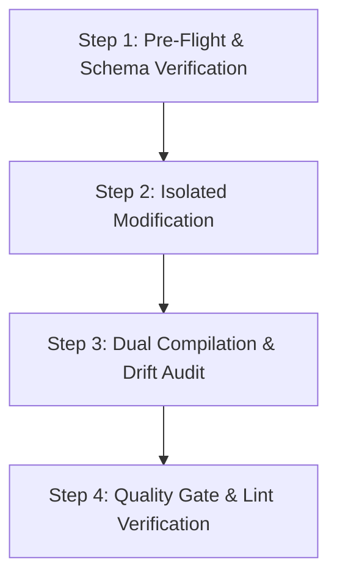

# Execution Loop & Agent Operating Playbook

Follow this 4-step execution loop whenever editing, generating, or extracting ad units with `@tools/ad-template-engine`.



---

## Step 1: Pre-Flight & Schema Verification

Before performing modifications:
1. Confirm that `schemaVersion` in `ad-data.yaml` is `ad-1.0`.
2. Check that the toolkit is isolated and dependencies are installed:
   ```bash
   npm run build --prefix tools/ad-template-engine
   ```
3. Read the target section in `ad-data.yaml` to confirm the existing card array order and section ID.

---

## Step 2: Isolated Modification

### Mode A: Schema-First (Recommended)
1. Apply changes to `templates/ppompu-ad-design-system/ui_kits/ppompu-ad/ad-data.yaml`.
2. **Left/Right Placement Rule:**
   - "Add to the left of X" → **Prepend** the new card before X in `cards: [...]`.
   - "Add to the right of X" → **Append** or insert after X in `cards: [...]`.
3. **Card Styling Rule:**
   - Use `style: "pro"` for promoted or terracotta highlighted tiers.
   - Use `style: "best"` for dark border flagship tiers.
   - Use `style: "normal"` for standard tiers.
4. **Notice Synchronization Rule:**
   - Whenever a new product tier is added to `cards`, add a corresponding bullet to `notices[].content`.

### Mode B: Direct HTML Modification + Reverse Sync
1. Apply component HTML changes directly to `redesign-v5v1.html`.
2. Ensure the card container contains `border-radius: 16px` and card headers use `justify-content: space-between`.
3. Immediately run the extraction pipeline to update the canonical schema:
   ```bash
   npm run extract --prefix tools/ad-template-engine
   ```

---

## Step 3: Dual Compilation & Drift Audit

1. Compile the static HTML from schema:
   ```bash
   npm run generate --prefix tools/ad-template-engine
   ```
2. Verify exit code `0` and check output at `templates/ppompu-ad-design-system/ui_kits/ppompu-ad/dist/index.html`.
3. If syncing with active template file:
   ```bash
   cp templates/ppompu-ad-design-system/ui_kits/ppompu-ad/dist/index.html \
      templates/ppompu-ad-design-system/ui_kits/ppompu-ad/redesign-v5v1.html
   ```
4. Verify round-trip idempotency:
   ```bash
   npm run extract --prefix tools/ad-template-engine
   git diff templates/ppompu-ad-design-system/ui_kits/ppompu-ad/ad-data.yaml
   ```
   *(Diff should be empty or strictly reflect intentional changes).*

---

## Step 4: Quality Gate & Lint Verification

Before concluding the session:
1. Run structural policy linting:
   ```bash
   npm run lint:structure
   ```
2. Run comprehensive linter:
   ```bash
   npm run lint
   ```
3. Run unit tests to ensure zero collateral damage:
   ```bash
   npm run test:unit
   ```
